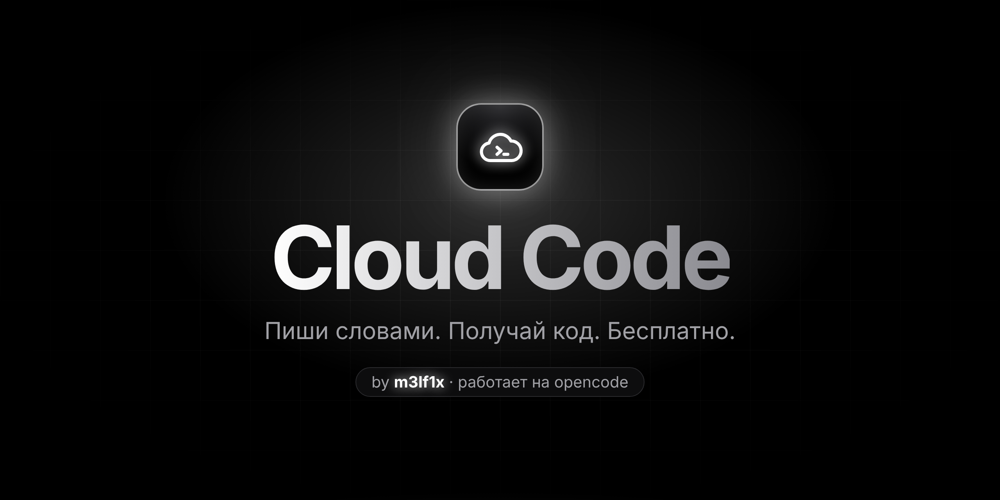
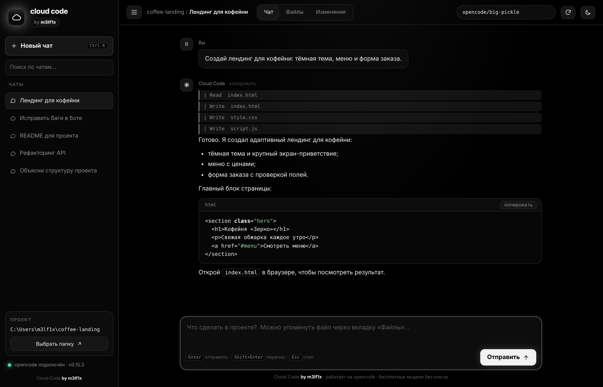
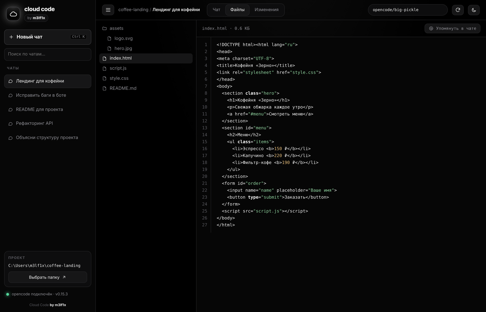
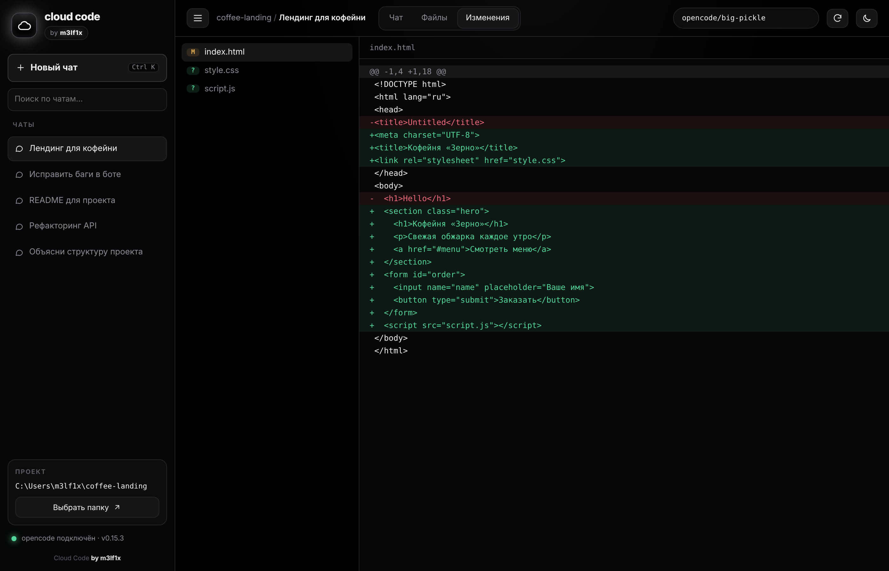

 <div align="center">

# Cloud Code

**Бесплатный AI-разработчик для твоих проектов.** Пиши задачу словами — получай код и изменения прямо в файлах.

[Python](https://www.python.org/) · [opencode](https://opencode.ai/) · [License](https://github.com/m3lf1x/Cloud-code/blob/main/LICENSE)



**by m3lf1x**

</div>

---

## Что это

Cloud Code — десктопное приложение с интерфейсом в стиле Claude Code, которое работает поверх [opencode](https://opencode.ai/) и бесплатных моделей. Ни ключей API, ни подписки: устанавливаешь зависимости, выбираешь папку проекта и ставишь задачу обычным языком.

Интерфейс написан на HTML и открывается в окне Python через `pywebview`. Всё в одном файле.

## Скриншоты

<p align="center">
  
  <br><sub><b>Чат.</b> Потоковые ответы, подсветка кода и кнопка «копировать».</sub>
</p>

<p align="center">
  
  <br><sub><b>Файлы.</b> Дерево проекта и просмотр кода с подсветкой.</sub>
</p>

<p align="center">
  
  <br><sub><b>Изменения.</b> Цветной diff из git по каждому файлу.</sub>
</p>

## Возможности

- **Бесплатно.** Автоматически выбирается бесплатная модель opencode. Свои провайдеры подключаются через `opencode auth login`.
- **Работает с твоим проектом.** Агент читает и правит файлы в выбранной папке.
- **Потоковые ответы.** Текст печатается по мере генерации, есть таймер и кнопка «Стоп».
- **Чаты с контекстом.** История сохраняется, поиск по чатам, диалог можно продолжить после перезапуска.
- **Файлы проекта.** Дерево файлов, просмотр с подсветкой синтаксиса, упоминание файла в чате через `@`.
- **Изменения.** Список изменённых файлов из git и цветной diff.
- **Markdown и код.** Заголовки, списки, блоки кода с подсветкой и кнопкой «копировать».
- **Быстрые команды.** Набери `/` в поле ввода: `/объясни`, `/ошибки`, `/ревью`, `/тесты`, `/рефактор`, `/readme`, `/коммит`, `/план`.
- **Режим «план».** Агент только анализирует проект и ничего не меняет в файлах.
- **Повторить ответ**, время генерации и **экспорт чата в Markdown**.
- **Проверка обновлений.** Программа сама сообщит о новой версии.
- **Тёмная и светлая тема**, горячие клавиши, сворачиваемая панель.

## Установка

### Требования

- Python 3.10+
- Node.js
- opencode

### Установка зависимостей

1. Установи [Python](https://www.python.org/) и [Node.js](https://nodejs.org/).
2. Установи opencode:

   ```bash
   npm i -g opencode-ai
   ```

3. Склонируй репозиторий:

   ```bash
   git clone https://github.com/m3lf1x/Cloud-code.git
   cd Cloud-code
   ```

4. Установи Python-зависимости:

   ```bash
   pip install pywebview
   ```

5. Запусти приложение:

   ```bash
   python main.py
   ```

## Использование

1. Нажми **«Выбрать папку»** и укажи свой проект.
2. Напиши задачу, например: *«Создай лендинг для кофейни: тёмная тема, меню и форма заказа»*.
3. Смотри, как агент работает, во вкладках **Файлы** и **Изменения**.

### Горячие клавиши

| Клавиша | Действие |
|---|---|
| `Enter` | Отправить сообщение |
| `Shift + Enter` | Новая строка |
| `Esc` | Остановить ответ |
| `/` | Быстрые команды |
| `Ctrl + K` | Новый чат |
| `Ctrl + B` | Свернуть боковую панель |
| `Ctrl + 1 / 2 / 3` | Чат / Файлы / Изменения |

## Как это работает

```text
Интерфейс (HTML/CSS/JS)  ←→  pywebview  ←→  Python  ←→  opencode run  ←→  модель
```

Каждое сообщение уходит в `opencode run` в выбранной папке. Контекст диалога и текст запроса передаются через stdin, ответ читается потоком и показывается в интерфейсе. Чаты и настройки хранятся в `~/.cloud_code`.

## Частые вопросы

**opencode не найден.** Установи его:

```bash
npm i -g opencode-ai
```

Перезапусти приложение. Программа ищет opencode в `PATH` и стандартных папках установки.

**Пустой ответ.** Нажми кнопку обновления рядом с полем модели и выбери рабочую бесплатную модель. Проверь интернет.

**Где хранятся чаты?** В папке `.cloud_code` в твоей домашней директории (`chats.json`, `config.json`).

## История версий

**1.1.1**
- Понятное окно ошибки при сбое запуска.
- Лог ошибок `~/.cloud_code/error.log`.
- Улучшенная диагностика.

**1.1.0**
- Быстрые команды через `/`.
- Режим «план» (только чтение).
- Повторить ответ, время генерации, экспорт чата в Markdown.
- Кнопка «Открыть папку проекта».
- Проверка обновлений.

**1.0.0** — первый релиз.

## Дисклеймер

Cloud Code — независимый open source проект. Он не связан с Anthropic и не является их продуктом. Название отсылает к идее и не означает аффилированности.

## Лицензия

MIT. Делай что хочешь, оставь авторство.

---

<div align="center">

**Cloud Code by m3lf1x**

Если проект полезен, поставь звезду ⭐

</div>
